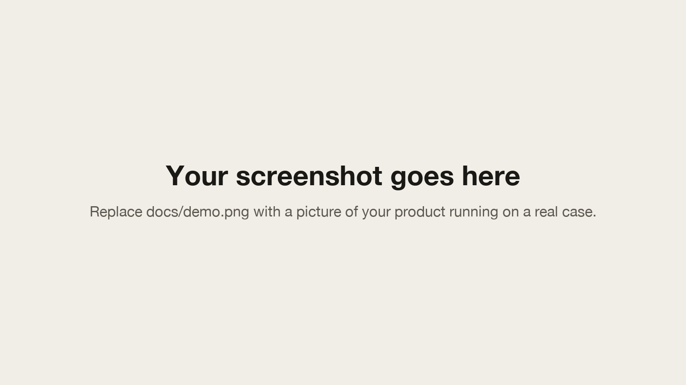

# [Product name]

<!-- This file is your Product Page. Replace everything in [brackets] with your own words.
     Your page updates about a minute after you commit. Never put an API key here: this page is public. -->

[One sentence: who it's for, and the job it does for them.]

[See it work](#see-it-work) · [Try it](https://example.com) · [Code](https://github.com/gen-ai-lab-f26/your-repo)

## Who it's for

**The person:** [A real person or group you can test with before December 8.]

**Today:** [How they do this job now, and what is slow, manual or broken about it.]

**With [product name]:** [What changes for them in one sitting.]

## See it work

[Watch our 90-second demo video](https://example.com) (add the link before December 8)

## How it works

1. [What goes in]
2. [What the AI does]
3. [What code checks, where a model on its own would slip]
4. [Where a person reviews or approves]
5. [What comes out]

## Evidence

Baseline: [doing it by hand, or a plain AI chat]. The full log is in [TEST_LOG.md](https://github.com/gen-ai-lab-f26/your-repo/blob/main/TEST_LOG.md).

| Check | Baseline | [Product name] |
| --- | --- | --- |
| [Check 1] | [Pass or fail] | [Pass or fail] |
| [Check 2] | [Pass or fail] | [Pass or fail] |
| [Check 3] | [Pass or fail] | [Pass or fail] |
| [Check 4] | [Pass or fail] | [Pass or fail] |
| [Check 5, meant to break it] | [Pass or fail] | [Pass or fail] |

### Outside testers

[What two or three people outside your team did when you handed it over without coaching, and where they got stuck.]

### What broke, and what we changed

[One real failure, how you found it, and the fix.]

## What it costs

**Per run:** [$0.00], measured by [how you measured it].

**At 50 users:** [Your estimate for a week of real use.]

## Our call

**[Ready for real users / Needs another round / Stop here]**

[Two or three sentences on why, pointing to your evidence.]

## Build log

### Ideation & build studio · November 24

[Your initial idea, repo setup, what you started building, and what you learned in class.]

### Build studio · December 1

[What changed, and what your outside testers found.]

### Final demo · December 8

[What shipped, and what you would do next.]

## Who did what

[Name: what they owned. One line each.]

Models and tools used: [List them.]
